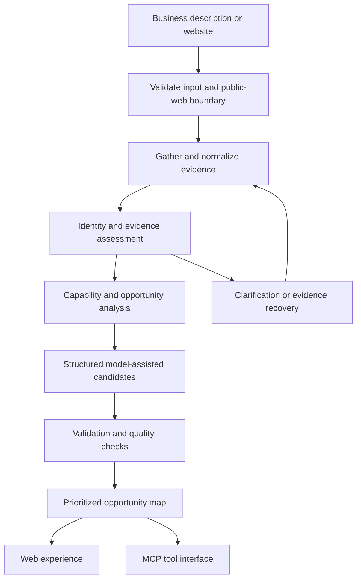

# Peachity — AI Strategy, Production Engineering & Technical Leadership

[Peachity](https://www.peachity.com) is a founder-led technology business focused on Production Readiness Reviews, production engineering for AI-built software, and fractional CTO leadership for non-technical founders. [Peachity Studio](https://www.peachity.com/studio) offers smaller, defined projects involving brand identity and design, MVP builds, and focused digital solutions.

This engineering case study focuses specifically on Peachity's AI Opportunity Map: an evidence-grounded assessment engine that identifies and prioritizes opportunities for AI, automation, and software.

## Product

The Opportunity Map accepts website or business context, gathers evidence, assesses business identity and needs, builds candidate opportunities, and returns a prioritized map with implementation guidance. The engine is exposed through a web experience and an MCP interface.

## Problem

A generic model can recommend AI without establishing what a business does, whether evidence is sufficient, or whether ordinary software is the better intervention. Assessment needs grounded recommendations, explicit uncertainty, and a useful path from findings to action.

## What I Built

I designed and built the assessment pipeline, evidence handling, structured opportunity validation, prioritization, web presentation, and MCP tool surface. The repository contains implementation and tests for routing, identity, evidence sufficiency, candidate validation, execution recommendations, deadlines, quality checks, and website-crawl safety.

## What This Demonstrates

Applied-AI pipeline design · evidence-grounded recommendations · structured outputs · model/deterministic separation · constrained website discovery · failure handling · MCP integration · testable decision logic.

## Architecture

This diagram shows product and service boundaries, not infrastructure topology or database structure.

## Technical Stack

Next.js · React · TypeScript · Zod · OpenAI structured-response integration · Model Context Protocol SDK and Apps extension · Cheerio · Supabase Auth/persistence adapters · Node test runner via tsx · Vercel deployment configuration.

## Engineering Decisions

### 1. Establish business identity before prescribing solutions

The pipeline evaluates identity and evidence sufficiency before accepting recommendations. Clarification and evidence recovery are part of the workflow rather than silently filling gaps with confident guesses.

### 2. Separate deterministic assessment from model judgment

Evidence extraction, routing, validation, and prioritization remain application logic around structured model calls. The model proposes or refines; the system determines whether a candidate can be accepted.

### 3. Allow software and operational fixes to outrank AI

The implementation distinguishes work scale, implementation effort, and execution paths. Recommendations can point to an ordinary product improvement or internal action instead of assuming every problem warrants an AI agent.

### 4. Budget long-running analysis explicitly

Stage deadlines, remaining-time checks, failure classification, and recovery paths bound the assessment. Useful output and uncertainty handling matter more than treating every successful model response as a completed assessment.

### 5. Reuse the assessment behind an MCP boundary

A typed tool interface exposes the analysis system through MCP as well as the web experience. Surface-specific persistence behavior keeps the assessment logic reusable without forcing identical data retention across entry points.

## Production Considerations

The repository includes tests for malformed and failed model paths, identity resolution, recommendations, quality, routing, MCP behavior, and website-crawl safety. Input validation, public-URL checks, rate limits, staged execution budgets, and persistence abstractions support the runtime. The case study documents those controls without revealing internal scoring weights, commercial routing rules, prompts, or customer inputs.

## Current Implementation and Direction

The assessment engine and MCP server are implemented. This portfolio does not claim marketplace availability, certification of the MCP integration, a customer deployment, or measured business outcomes.

## Product Walkthrough

The implemented web workflow takes business context through the analysis API and renders a structured opportunity map with recommended changes, effort, human decision boundaries, and business-context questions.

This result was generated through the actual local web form and analysis endpoint using a fictional business description. It uses the application's deterministic development path without a live model provider; the output is the system's response, not a manually composed result.

[View the short workflow walkthrough](docs/product-walkthrough.md).

## Verified Engineering Evidence

**13 focused tests passed** for candidate validation, MCP analysis/refinement behavior, and public-URL safety. They verify rejection of generic candidates, acceptance of an intentional empty portfolio, MCP operation without map persistence, blocking of private/internal addresses, and crawler disallow handling. A separate browser check completed the local form → analysis API → result view workflow with synthetic input.

Checks were run on October 13, 2026. Test results describe the stated scope and are not customer or business outcome claims.

## Source Policy

Peachity’s proprietary assessment logic and application source stay in private repositories. This independently written case study presents high-level engineering decisions without disclosing customer inputs, credentials, internal prompts, commercial scoring rules, detailed schemas, or security-sensitive implementation details.
