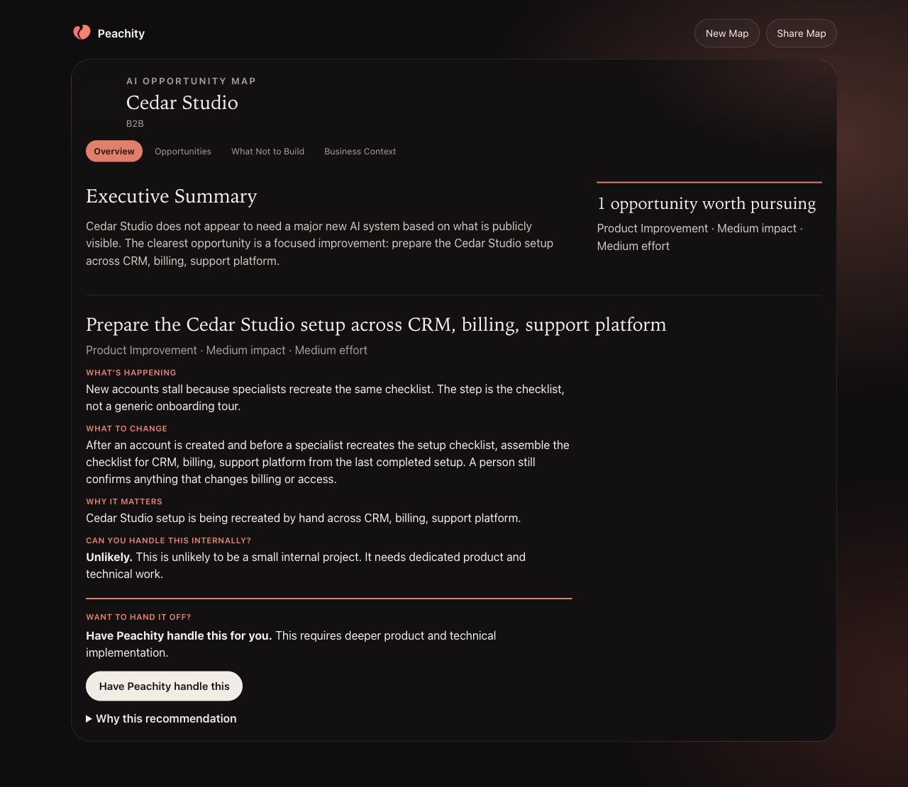
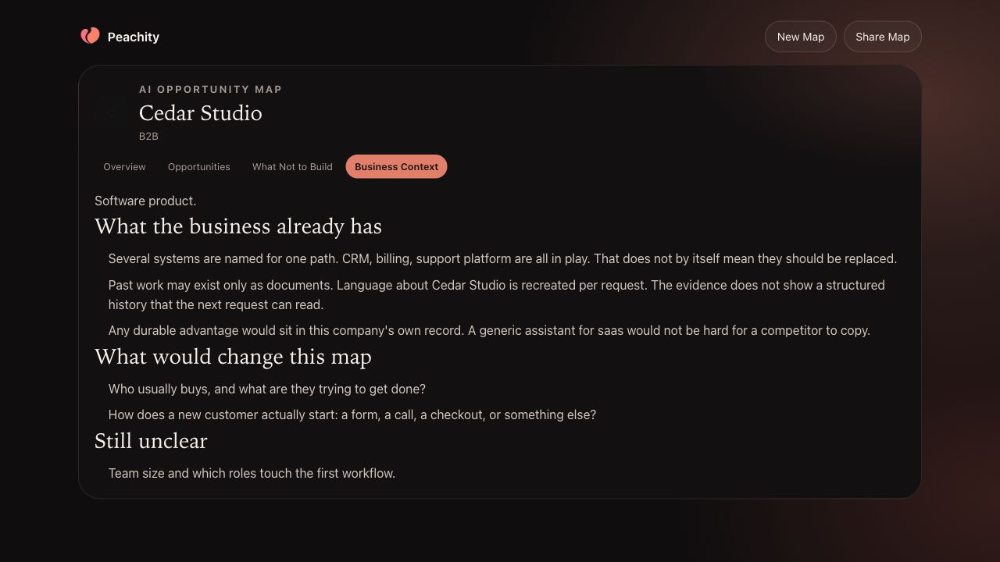

# Peachity: business context to an Opportunity Map

## 1. Supply synthetic business context

The real local web form received this fictional description, with no website URL:

> Cedar Studio is a fictional B2B software company. Its customer portal connects a billing system, CRM and support inbox. New accounts stall during onboarding because implementation staff repeatedly recreate a setup checklist for those connections. We want to prepare that checklist from existing account context while keeping billing and access decisions under human review. This is synthetic portfolio data.

## 2. Review the generated recommendation

The form called the application's analysis endpoint, received its streamed result, and opened the map view. The result identifies a focused setup-workflow improvement and preserves human confirmation for billing and access changes. Its effort and impact labels are assessment output, not measured business results.

## 3. Inspect context and uncertainty

Opening **Business Context** shows the systems identified in the input and questions that would change the assessment. The UI makes uncertainty available alongside recommendations.

**Capture method:** the actual web form, analysis API, and result components running locally. This capture uses the deterministic development path without a live model provider or public-web crawl. Local development storage/session state supports the result view; it is not evidence of production database persistence. The screenshots contain synthetic business data only.
